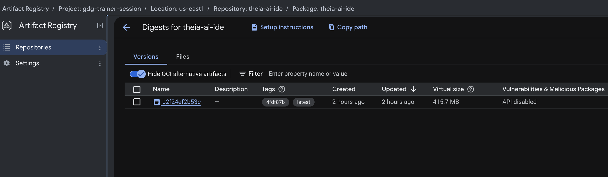
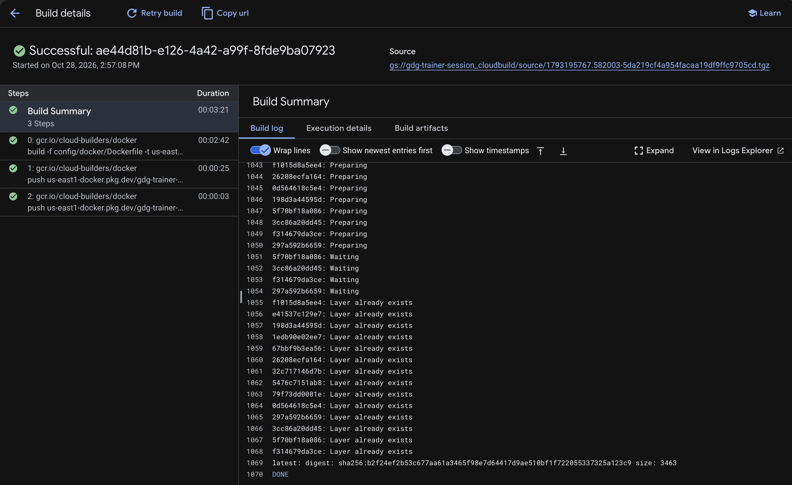
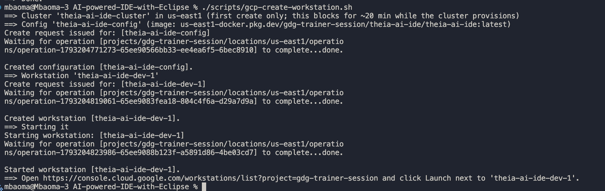
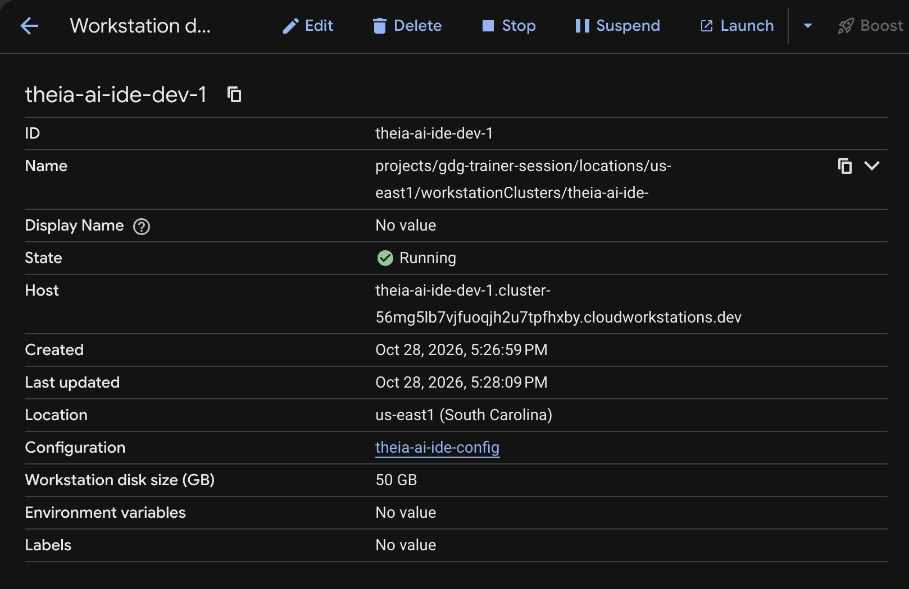
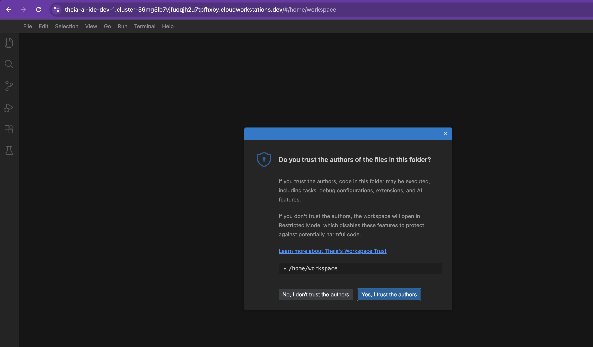

# AI-powered-IDE-with-Eclipse

A customizable, secure, and scalable development workspaces using Eclipse Theia and Google Cloud

## Layout

```markdown
config/                 Single source of truth for IDE configuration
  theia.app.json        Branding, default preferences, bundled VS Code extensions
  .env.example          Template for Phase 3 AI credentials (not used yet)
ide/                    The scaffolded Theia browser application
scripts/
  setup.sh              Install deps, sync config, build, download plugins
  start.sh              Launch the IDE against workspace/
  smoke-test.sh         Headless boot + health check (see "Testing" below)
  sync-theia-config.js  Merges config/theia.app.json into ide/package.json
workspace/              Sample project opened by the IDE (one file per language)
```

## Prerequisites

Required for Phase 1:

| Tool | Why | Check |
|---|---|---|
| Node.js 20 or 22 LTS | Runs Theia's build/backend | `node -v` |
| Yarn 1.x | Theia's supported package manager | `yarn -v` |
| Git | Source control view | `git --version` |
| Python 3 | Running/debugging the Python sample | `python3 --version` |
| A JDK (17+) | Java language features and debugging | `java -version` |

## Setup and run

```bash
./scripts/setup.sh      # install deps, build, download bundled extensions
./scripts/start.sh      # starts the backend and opens workspace/
```


In a browser, type in `http://localhost:3000` and you should be able to:

- open `hello.js` / `hello.py` / `Hello.java`
- open a terminal and run the files directly

```bash
node hello.js

python3 hello.py

javac Hello.java
javac Hello.java && java Hello world
```


- press **F5 to debug** via the launch configs in `workspace/.vscode/launch.json`


## Testing

```bash
./scripts/smoke-test.sh
```


The test does the following:

- boots the backend on a scratch port
- confirms it serves HTTP 200 with the branded page, confirms the bundled plugins deployed, then shuts it down.

## Bundled extensions

Resolved from the [Open VSX registry](https://open-vsx.org) and pinned by version in
`config/theia.app.json`:

| Extension | Purpose |
|---|---|
| `vscode.git`, `vscode.git-base` | Source control view |
| `vscode.typescript-language-features` | JS/TS IntelliSense |
| `vscode.json-language-features`, `vscode.npm` | Editing config/`package.json` files |
| `ms-python.python` + `ms-python.debugpy` | Python IntelliSense (Jedi-based) and debugging |
| `ms-vscode.js-debug` | Node.js debugging |
| `redhat.java`, `vscjava.vscode-java-debug` | Java IntelliSense (Eclipse JDT LS) and debugging |

## Phase 2: Google Cloud Deployment

Containerizes the Phase 1 IDE and runs it on Google Cloud Workstations.

**Goal:** any authorized developer can launch a browser-based workstation from a custom container image in under ~60s, with persistent storage.

**What it adds:**

| File / resource | Purpose |
|---|---|
| `Dockerfile` | Packages the Theia app, language runtimes (Node, Python, JDK),  CLI tools into one pinned image |
| `cloudbuild.yaml` | Cloud Build pipeline |
| Workstation cluster and config | References the custom image, sets machine type, resource limits, idle/auto-shutdown timeouts |
| Networking | Private IP / VPC-SC for the cluster, firewall rules, Cloud NAT for outbound package installs |

**Exit criteria:** a workstation launches from the custom image in under ~60s and its state persists across sessions.

**Prerequisites:**

| Tool / account | Why | Check |
|---|---|---|
| GCP project with billing enabled | Hosts the Workstations, Artifact Registry, and Cloud Build resources | — |
| `gcloud` CLI, authenticated | Provisioning and deploys | `gcloud auth list` |
| Workstations, Artifact Registry, Cloud Build APIs enabled on the project | Required services | `gcloud services list --enabled` |
| Docker | Build/test the container image locally before pushing | `docker --version` |

### Build and deploy

```bash
cp config/gcp/deploy.env.example config/gcp/deploy.env
# edit config/gcp/deploy.env

./scripts/gcp-enable-apis.sh  
./scripts/gcp-network-setup.sh (optional)

./scripts/docker-smoke-test.sh 
./scripts/gcp-build-and-push.sh
./scripts/gcp-create-workstation.sh
```





`gcp-create-workstation.sh` prints a console URL at the end, open it and click **Launch** next to the workstation name to open the IDE in your browser.







**Cleanup:**

```bash
./scripts/gcp-cleanup.sh
```

Deletes everything the scripts above created (workstation, config, cluster, Artifact Registry repo, and any dedicated network/NAT) so nothing keeps billing. Prompts for confirmation; pass `-y` to skip it.

## Documentation

- [Eclipse Theia docs](https://theia-ide.org/docs/): user and adopter documentation for the Theia platform this IDE is built on
- [Eclipse Theia GitHub](https://github.com/eclipse-theia/theia): source, extension API, and issue tracker
- [Theia CLI (`@theia/cli`) README](https://github.com/eclipse-theia/theia/blob/master/dev-packages/cli/README.md): `theia build` / `theia start` / `theia download:plugins`, used throughout `scripts/`
- [Authoring VS Code Extensions for Theia](https://theia-ide.org/docs/authoring_vscode_extensions/): how the bundled extensions in `config/theia.app.json` get built and published
- [Open VSX Registry](https://open-vsx.org): the bundled extensions
- [Eclipse Foundation](https://www.eclipse.org/): project governance and the Eclipse ecosystem
