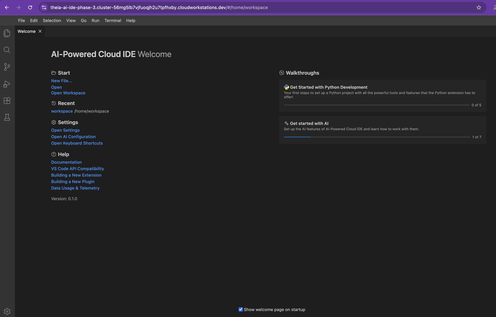
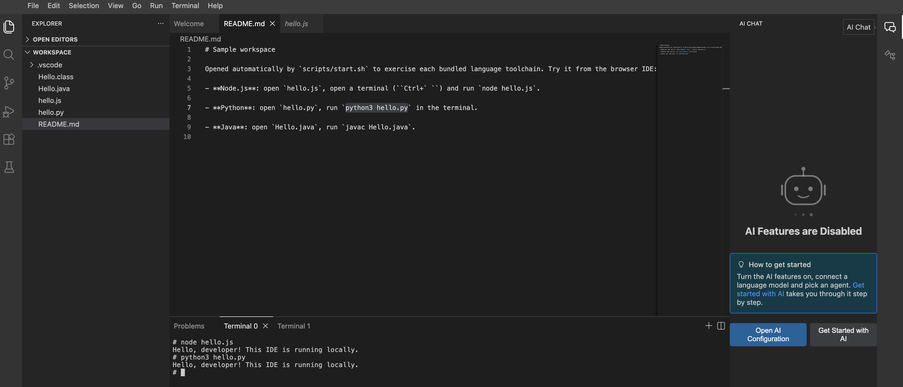
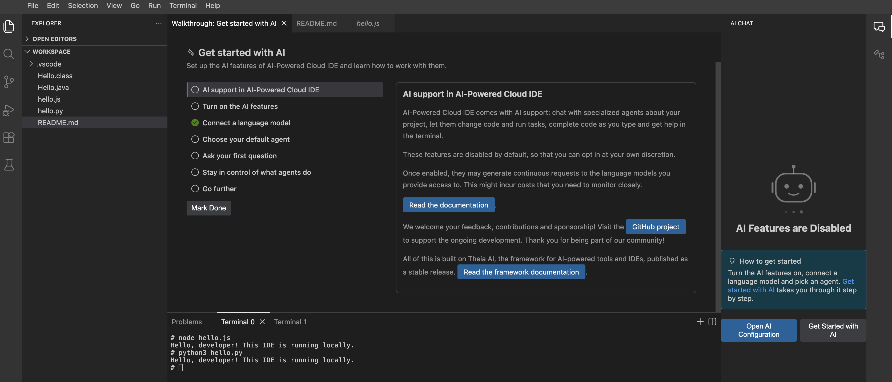
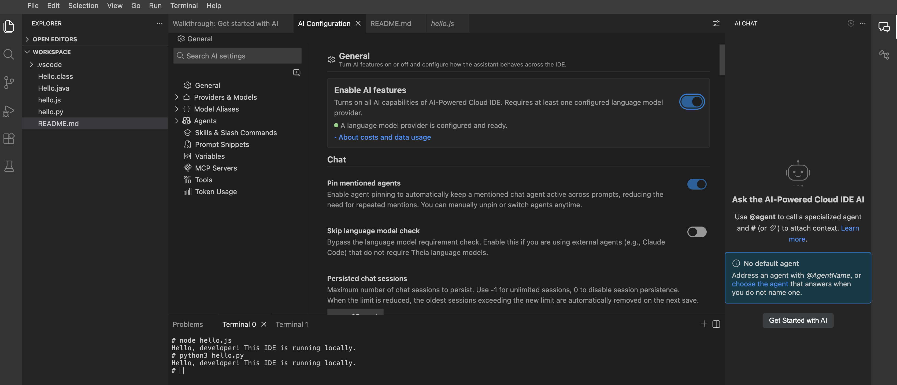
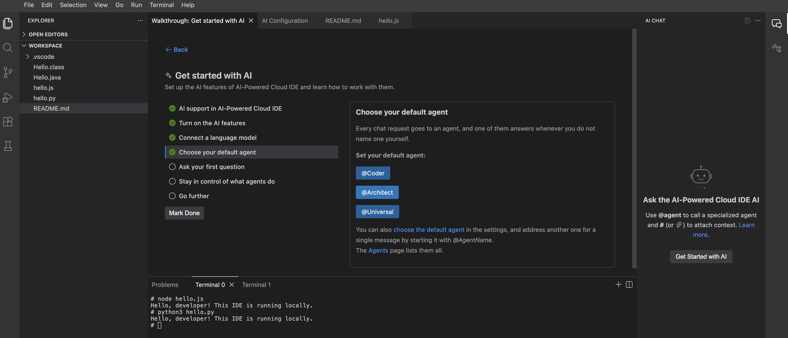
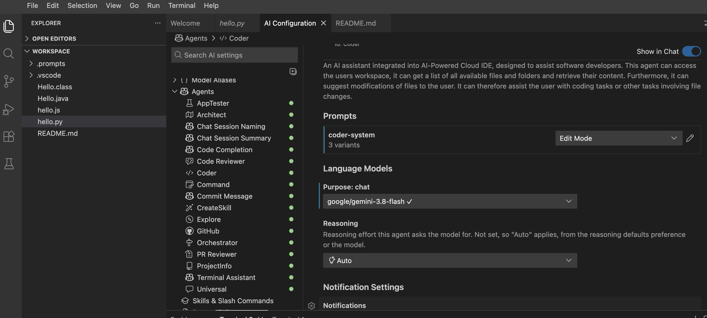
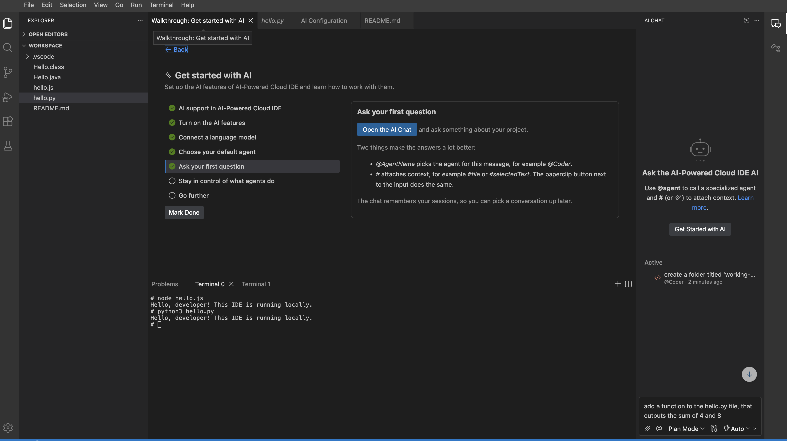
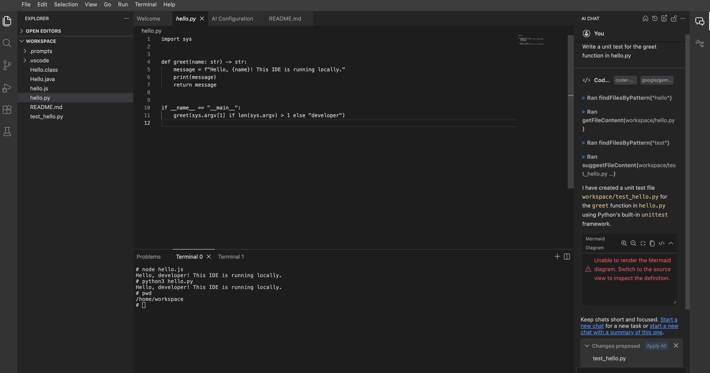

# AI-powered-IDE-with-Eclipse

A customizable, secure, and scalable development workspaces using Eclipse Theia and Google Cloud

## Layout

```markdown
config/                 Single source of truth for IDE configuration
  theia.app.json        Branding, default preferences, bundled VS Code extensions
  .env.example          Template for Phase 3 AI credentials (not used yet)
ide/                    The scaffolded Theia browser application
scripts/
  setup.sh              Install deps, sync config, build, download plugins
  start.sh              Launch the IDE against workspace/
  smoke-test.sh         Headless boot + health check (see "Testing" below)
  sync-theia-config.js  Merges config/theia.app.json into ide/package.json
workspace/              Sample project opened by the IDE (one file per language)
```

## Phase 3: AI Integration

Wires Gemini into the IDE through Theia AI's built-in Google AI provider, using the **free-tier Gemini Developer API** (so this costs nothing to develop against).

**Why the free Developer API instead of Vertex AI:** Vertex AI is GCP's enterprise route while Gemini Developer API, via Google AI Studio, gives free, rate-limited access to current Gemini models with just an API key (a better fit for development). Vertex AI remains an option for a later production purpose.

**Theia AI already supports this natively**: Google AI is a first-class provider alongside Anthropic/OpenAI/Ollama, configured via a `GOOGLE_API_KEY` environment variable or in-app preferences.

**Free models check [here](https://ai.google.dev/gemini-api/docs/pricing) for the current list**

| Model | Use it for | Why |
|---|---|---|
| `gemini-3.8-flash` | Chat-based debugging, "explain this code", commit-message generation | Current flagship with the broadest free-tier access |
| `gemini-3.5-flash-lite` | Inline completion | Fastest and cheapest model |

> **Avoid `gemini-3.1-pro` and `gemini-4-argon`.** Both show up in the auto-discovered model list (they're real models) but have **zero free-tier quota** -- paid-only. Assigning either to any agent fails on the first request with `Error 429: ... limit: 0 ... Free Tier`. If you hit this, it means an agent (often "Coder") got pointed at one of these; go to AI Configuration → Agents and switch it to `gemini-3.8-flash` or `gemini-3.5-flash-lite`.

**Exit criteria:** AI assistance works from inside the IDE -- local (Phase 1) or the Phase 2 cloud workstation, the wiring is the same either way -- authenticated with a free-tier API key (not baked into the image), and usage stays within free-tier rate limits.

**Prerequisites:**

| Tool / account | Purpose |
|---|---|
| A Google account | Required to generate a Gemini API key
| Gemini API key from [Google AI Studio](https://aistudio.google.com/apikey) | Free, no credit card, no GCP project required





## Using Gemini in the IDE

**1. Add your key and start the IDE:**

```bash
cp config/.env.example config/.env
./scripts/start.sh
```

[AI Enabled IDE](theia-ai-ide-phase-3.cluster-56mg5lb7vjfuoqjh2u7tpfhxby.cloudworkstations.dev)

**2. Open AI Configuration** (`Ctrl+Shift+P` / `Cmd+Shift+P`, "AI: Open Configuration", or the sparkle icon in the activity bar) and check **Models** (Gemini models should already be listed).





**3. Under Agents, pick which model handles what**: you can pick `gemini-3.8-flash` for chat/reasoning and `gemini-3.5-flash-lite` for code completion.

**Don't pick `gemini-3.1-pro` or `gemini-4-argon`** because despite being listed, they're paid-only and fail immediately with an Error 429.





**4. Open AI Chat** (same command palette, search "AI: Open Chat", or the sparkle icon) and start prompting.



**Sample queries to try**, using the sample workspace:

- With `hello.py` open: *"Explain what this file does."*
- With `hello.js` open: *"Add a check for a missing name argument and print a usage message instead."*
- *"Write a unit test for the greet function in hello.js."*
- *"What would the Java equivalent of hello.py's greet function look like?"*
- In the integrated terminal, after a failed command: ask the chat *"Why did that last command fail?"*



## Documentation

- [Eclipse Theia docs](https://theia-ide.org/docs/): user and adopter documentation for the Theia platform this IDE is built on
- [Eclipse Theia GitHub](https://github.com/eclipse-theia/theia): source, extension API, and issue tracker
- [Theia CLI (`@theia/cli`) README](https://github.com/eclipse-theia/theia/blob/master/dev-packages/cli/README.md): `theia build` / `theia start` / `theia download:plugins`, used throughout `scripts/`
- [Authoring VS Code Extensions for Theia](https://theia-ide.org/docs/authoring_vscode_extensions/): how the bundled extensions in `config/theia.app.json` get built and published
- [Open VSX Registry](https://open-vsx.org): the bundled extensions
- [Eclipse Foundation](https://www.eclipse.org/): project governance and the Eclipse ecosystem
- [Using AI Features in Theia IDE](https://theia-ide.org/docs/user_ai/): how Theia AI's provider/agent settings work, including the built-in Google AI provider Phase 3 uses
- [Gemini API docs](https://ai.google.dev/gemini-api/docs): the Developer API Phase 3 calls
- [Gemini API pricing / free tier](https://ai.google.dev/gemini-api/docs/pricing): current free-tier model list and limits
- [Google AI Studio](https://aistudio.google.com/apikey): where to generate the free `GOOGLE_API_KEY`
