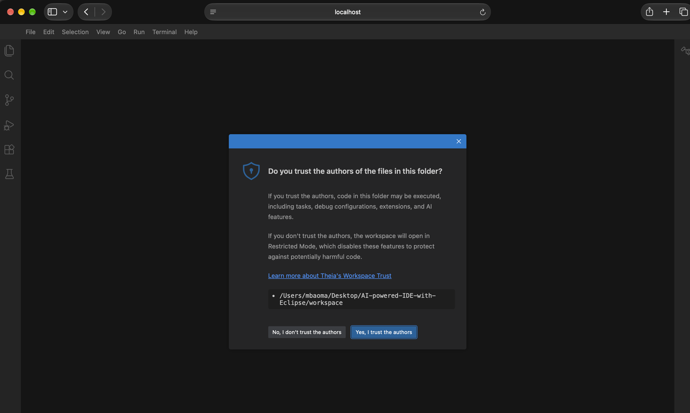
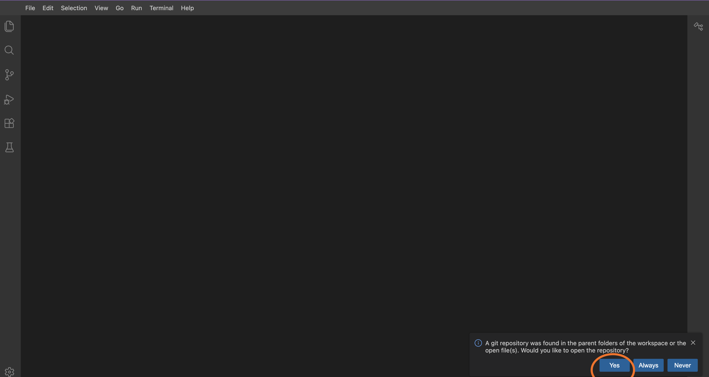
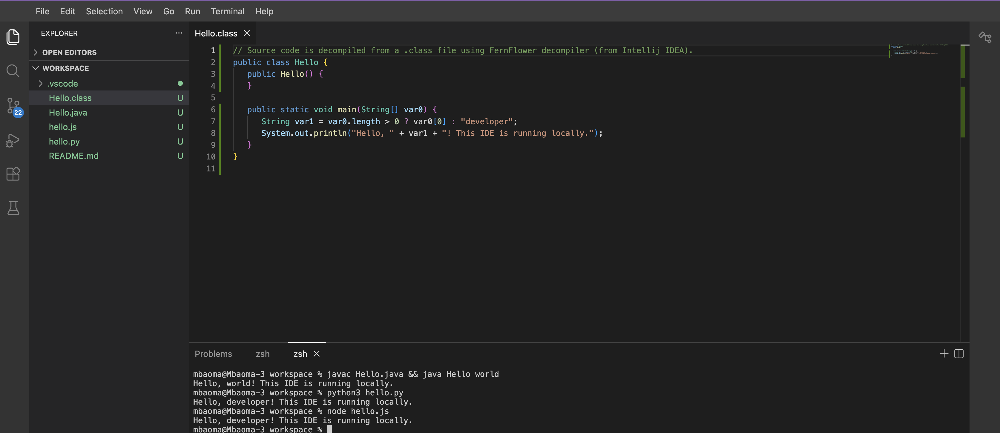
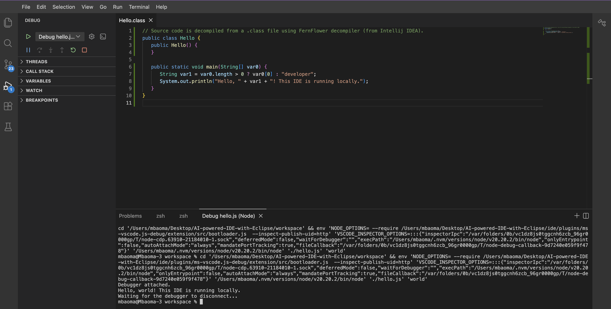
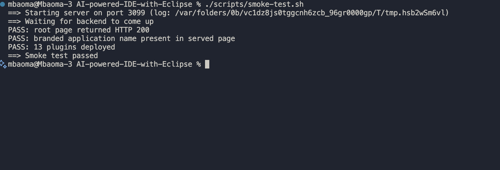

# AI-powered-IDE-with-Eclipse

A customizable, secure, and scalable development workspaces using Eclipse Theia and Google Cloud

## Layout

```markdown
config/                 Single source of truth for IDE configuration
  theia.app.json        Branding, default preferences, bundled VS Code extensions
  .env.example          Template for Phase 3 AI credentials (not used yet)
ide/                    The scaffolded Theia browser application
scripts/
  setup.sh              Install deps, sync config, build, download plugins
  start.sh              Launch the IDE against workspace/
  smoke-test.sh         Headless boot + health check (see "Testing" below)
  sync-theia-config.js  Merges config/theia.app.json into ide/package.json
workspace/              Sample project opened by the IDE (one file per language)
```

## Prerequisites

Required for Phase 1:

| Tool | Why | Check |
|---|---|---|
| Node.js 20 or 22 LTS | Runs Theia's build/backend | `node -v` |
| Yarn 1.x | Theia's supported package manager | `yarn -v` |
| Git | Source control view | `git --version` |
| Python 3 | Running/debugging the Python sample | `python3 --version` |
| A JDK (17+) | Java language features and debugging | `java -version` |

## Setup and run

```bash
./scripts/setup.sh      # install deps, build, download bundled extensions
./scripts/start.sh      # starts the backend and opens workspace/
```





In a browser, type in `http://localhost:3000` and you should be able to:

- open `hello.js` / `hello.py` / `Hello.java`
- open a terminal and run the files directly

```bash
node hello.js

python3 hello.py

javac Hello.java
javac Hello.java && java Hello world
```



- press **F5 to debug** via the launch configs in `workspace/.vscode/launch.json`



## Testing

```bash
./scripts/smoke-test.sh
```



The test does the following:

- boots the backend on a scratch port
- confirms it serves HTTP 200 with the branded page, confirms the bundled plugins deployed, then shuts it down.

## Bundled extensions

Resolved from the [Open VSX registry](https://open-vsx.org) and pinned by version in
`config/theia.app.json`:

| Extension | Purpose |
|---|---|
| `vscode.git`, `vscode.git-base` | Source control view |
| `vscode.typescript-language-features` | JS/TS IntelliSense |
| `vscode.json-language-features`, `vscode.npm` | Editing config/`package.json` files |
| `ms-python.python` + `ms-python.debugpy` | Python IntelliSense (Jedi-based) and debugging |
| `ms-vscode.js-debug` | Node.js debugging |
| `redhat.java`, `vscjava.vscode-java-debug` | Java IntelliSense (Eclipse JDT LS) and debugging |
